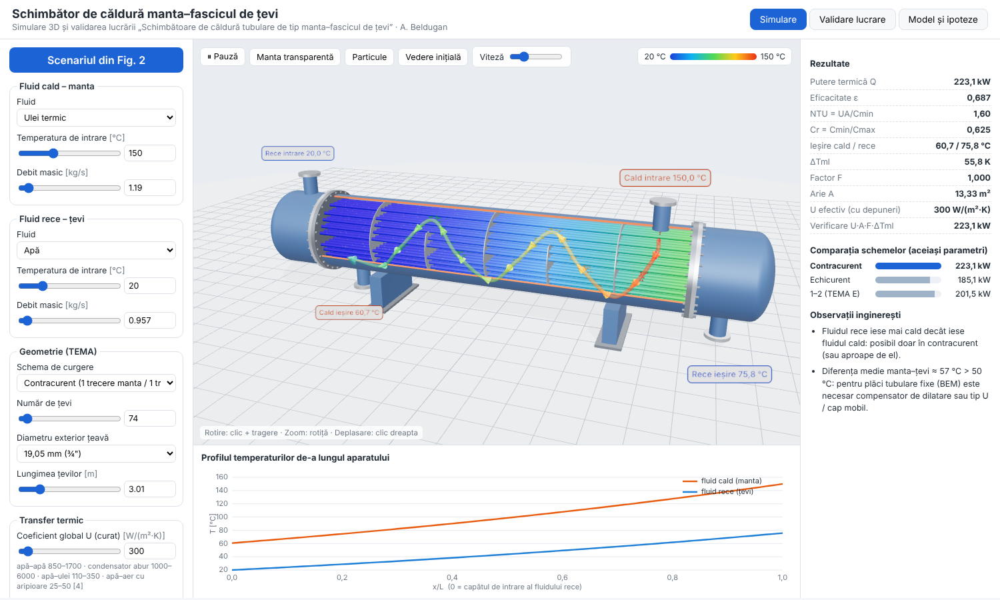
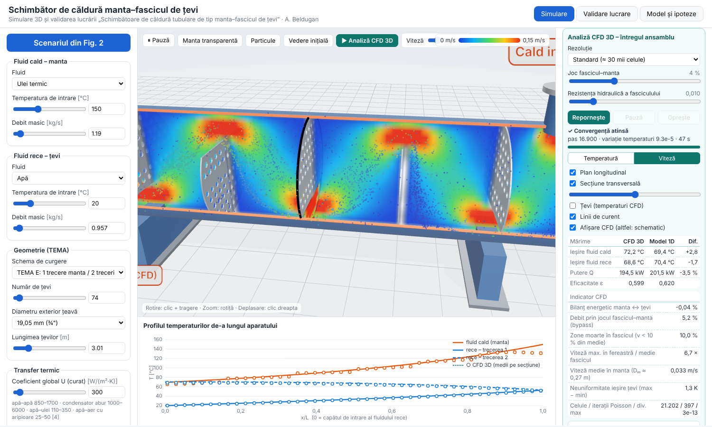
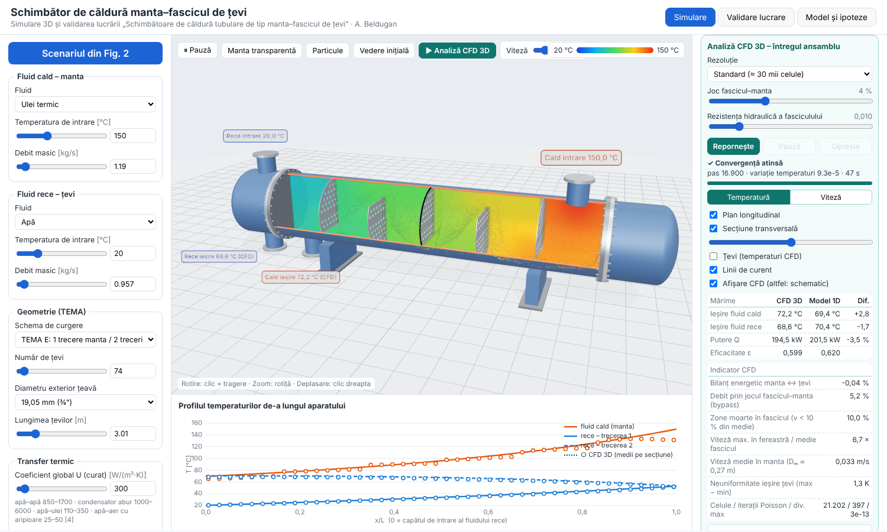
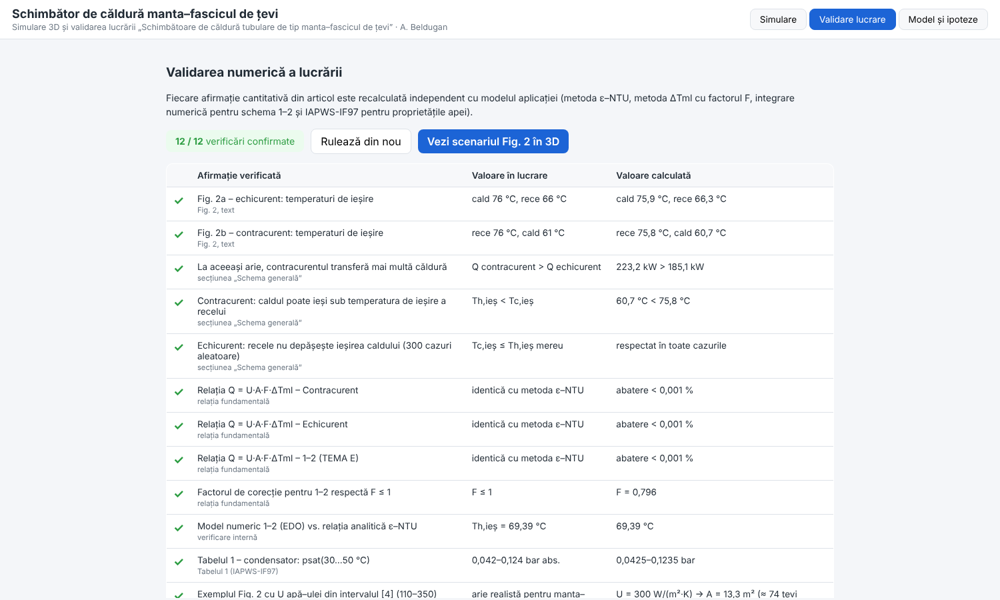

# Simulator 3D – schimbător de căldură manta–fascicul de țevi

Aplicație web interactivă care simulează funcționarea unui schimbător de căldură tubular de tip **manta–fascicul de țevi (TEMA)** și **validează numeric** afirmațiile din lucrarea
„*Schimbătoare de căldură tubulare de tip manta–fascicul de țevi: funcționare, tipuri constructive și provocări actuale*” (A. Beldugan, Universitatea „Ovidius” din Constanța).



## Ce face

- **Model 3D** cu secțiune prin manta: fascicul de țevi colorat după temperatura locală, șicane segmentate (tăietură 25 %), plăci tubulare, camere de distribuție, racorduri, flanșe și suporți.
- **Curgerea animată**: particulele și săgețile arată traseul în zigzag al fluidului din manta și curgerea prin țevi; culoarea indică temperatura.
- **Trei scheme de curgere**: contracurent, echicurent și TEMA E cu o trecere prin manta și două treceri prin țevi (1–2).
- **Parametri modificabili**: fluide, temperaturi de intrare, debite, număr/diametru/lungime țevi, coeficientul global U și rezistența de depunere R<sub>f</sub>.
- **Rezultate**: Q, ε, NTU, C<sub>r</sub>, temperaturi de ieșire, ΔT<sub>ml</sub>, factorul F, U efectiv, plus comparația celor trei scheme și observații inginerești (încrucișare de temperaturi, F < 0,75, necesar de compensator la BEM, efectul depunerilor).
- **Graficul profilelor de temperatură** de-a lungul aparatului (echivalentul Fig. 2 din lucrare).
- **Fila „Validare lucrare”**: recalculează independent fiecare afirmație numerică din articol.
- **Analiză CFD 3D a întregului ansamblu** (butonul „▶ Analiză CFD 3D”): calcul tridimensional al curgerii și al transferului de căldură în manta, cuplat cu fiecare canal de țevi; rezultatele apar direct în modelul 3D.

## Analiza CFD 3D



Solverul rulează în browser, într-un fir separat (Web Worker), pe geometria modelului 3D:

- **Curgerea din manta**: metoda Lattice-Boltzmann D3Q19 (BGK) pe 15–70 mii celule, cu șicanele segmentate, racordurile circulare, plăcile tubulare și jocul fascicul–manta.
- **Fasciculul de țevi**: mediu poros cu rezistență Darcy reglabilă (abordarea Patankar–Spalding).
- **Conservare exactă**: fluxurile sunt proiectate pe un câmp cu divergență nulă (ecuația Poisson pentru corecția de presiune, gradienți conjugați).
- **Transfer termic**: volume finite conservative în manta, cuplate cu bilanțul fiecărui canal de țevi (cu amestec în camera posterioară la schema 1–2); UA total este același ca în modelul 1D, astfel încât diferențele provin doar din curgerea reală.
- **Vizualizare**: plan longitudinal și secțiune transversală mobilă (temperatură sau viteză), linii de curent advectate în câmpul calculat, țevile colorate cu temperaturile CFD, profilul axial CFD suprapus peste graficul 1D.
- **Indicatori**: temperaturi de ieșire și putere CFD vs. ε–NTU, bilanț energetic, fracțiunea de ocolire (bypass), zone moarte, viteza în ferestrele șicanelor, neuniformitatea temperaturii la ieșirea din țevi.
- **Export**: imagine PNG a vederii 3D și fișier CSV cu rezultatele și profilul axial.

Exemplu (scenariul Fig. 2, contracurent): CFD 3D dă Th,ieș ≈ 64,6 °C față de 60,7 °C în modelul 1D (Q cu ≈ 4 % mai mic), cu ≈ 8 % debit de ocolire și ≈ 10 % zone moarte; bilanțul energetic se închide cu o eroare sub 0,1 %.

**Limite:** rețea grosieră, curgere laminară cu vâscozitate efectivă (fără model de turbulență), proporțiile modelului vizual (L/D ≈ 4,8). Rezultatele sunt calitative–semicantitative și servesc la înțelegerea fenomenelor; pentru proiectare se folosesc coduri CFD dedicate (ANSYS Fluent, OpenFOAM) sau metoda Bell–Delaware.





## Verificările efectuate

| Afirmație din lucrare | Metodă |
|---|---|
| Fig. 2a: echicurent → cald 76 °C, rece 66 °C | ε–NTU (NTU = 1,6; C<sub>r</sub> = 0,625) |
| Fig. 2b: contracurent → rece 76 °C, cald 61 °C | ε–NTU |
| Contracurentul transferă mai multă căldură la aceeași arie | comparație ε–NTU |
| În echicurent recele nu depășește ieșirea caldului | 300 cazuri aleatoare |
| Q = U·A·F·ΔT<sub>ml</sub> | comparație cu ε–NTU pentru toate schemele |
| F ≤ 1 pentru schema 1–2 | relația Bowman–Mueller–Nagle |
| Tabelul 1: p<sub>sat</sub>(30…50 °C) = 0,042–0,124 bar | IAPWS-IF97, regiunea 4 |
| Valorile U apă–ulei dau o arie realistă | U = 300 W/(m²·K) → A ≈ 13,3 m² |

## Rulare locală

Aplicația este statică (HTML + JavaScript, fără instalare). Din cauza modulelor ES, nu se deschide direct cu dublu-clic pe `index.html`; porniți un server local din folderul proiectului:

```bash
python -m http.server 8000
# apoi deschideți http://localhost:8000
```

Teste automate pentru modelul fizic și solverul CFD (Node.js ≥ 18):

```bash
npm test
```

## Publicare pe GitHub Pages

1. Creați un depozit nou pe GitHub și încărcați conținutul acestui folder (inclusiv folderul ascuns `.github`).
2. În depozit: **Settings → Pages → Build and deployment → Source: GitHub Actions**.
3. La fiecare `push` pe ramura `main`, workflow-ul `deploy.yml` rulează testele și publică aplicația la `https://<utilizator>.github.io/<depozit>/`.

Workflow-ul `tests.yml` rulează testele și la fiecare pull request.

## Structura

```
index.html          interfața
css/style.css       stiluri
js/physics.js       modelul termic (ε–NTU, ΔTml–F, EDO 1–2, IAPWS-IF97) + validarea lucrării
js/scene.js         modelul 3D (Three.js)
js/chart.js         graficul profilelor de temperatură
js/cfd3d.js         solverul CFD 3D (LBM D3Q19, mediu poros, proiecție Poisson, transfer termic)
js/cfd-worker.js    rularea solverului într-un fir separat
js/cfd-view.js      afișarea rezultatelor CFD în scena 3D
js/app.js           legătura dintre parametri, calcul, 3D și rezultate
tests/              teste Node (node:test)
vendor/             Three.js r187 (licență MIT), inclus local – fără CDN
```

## Ipoteze

Regim staționar, proprietăți constante, fără pierderi spre exterior și fără schimbare de fază; fluidul cald în manta, fluidul rece în țevi. Modelul 3D este schematic: numărul de țevi desenate nu urmărește parametrul N, iar traseul din manta ilustrează curgerea ideală în jurul șicanelor (fără curenți de ocolire și scăpări, cum ar face metoda Bell–Delaware).

## Bibliografie

1. S. Kakaç, H. Liu, A. Pramuanjaroenkij, *Heat Exchangers: Selection, Rating, and Thermal Design*, ed. 3, CRC Press, 2012.
2. R. K. Shah, D. P. Sekulić, *Fundamentals of Heat Exchanger Design*, Wiley, 2003.
3. TEMA, *Standards of the Tubular Exchanger Manufacturers Association*, ediția 2026.
4. T. L. Bergman, A. S. Lavine, F. P. Incropera, D. P. DeWitt, *Fundamentals of Heat and Mass Transfer*, ed. 7, Wiley, 2011.
5. IAPWS, *Revised Release on the IAPWS Industrial Formulation 1997 for the Thermodynamic Properties of Water and Steam*, 2007.
6. S. V. Patankar, D. B. Spalding, „A calculation procedure for the transient and steady-state behavior of shell-and-tube heat exchangers”, în *Heat Exchangers: Design and Theory Sourcebook*, Scripta Book Co., 1974.
7. T. Krüger et al., *The Lattice Boltzmann Method: Principles and Practice*, Springer, 2017.

## Licență

MIT – vezi `LICENSE`. Three.js este distribuit sub licența MIT (`vendor/THREE_LICENSE`).
